# TabApp

Split bills, keep tabs and get paid back. Live at **[tabapp.app](https://tabapp.app)**.

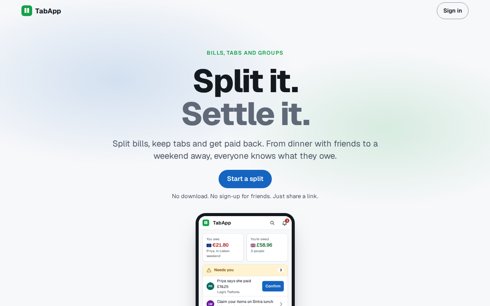

## What it does

**Split a bill from the receipt.** Take a photo of the receipt and TabApp reads it into items, tax, service and tip. You check the reading, then share one link. Everyone claims what they had, and each person sees what they owe and to whom.

**Friends join with a link, no account needed.** Anyone with the link can take a seat on the bill, claim their items and say they've paid. Signing in later keeps that seat on all their devices.

**Split items any way you like.** Each item can be split Even, by Units ("2 of the 3 beers"), by Shares, by Percent or by exact Amount. Extras like tax, service, tips and discounts are shared out across the bill. One person can pay the whole bill, or several can each put something in.

**Get paid back.** TabApp keeps count and never moves money. It suggests who pays whom. The sender says they've paid, and the person paid confirms it. Saved bank details and payment handles are shown to the people who owe you, and email, text or push reminders nudge the rest.

**Tabs for things that run over time.** A weekend away or a shared flat becomes a tab. Anyone in it can add bills to one running ledger, and the balances always sum to zero.

**Groups for the people you split with often.** A group is a home for its tabs and bills, which start with its people already added.

**Know where you stand.** Balances and a statement show everything you owe and are owed across bills and tabs. The statement keeps a running balance and exports to CSV or PDF.

**Works offline, installs like an app.** Bills you've opened can be read with no connection, and a new bill can be started. It installs from the browser, and the Android and Windows store apps are packages of the same site.

**In your language and your style.** TabApp comes in English, Spanish, French, Portuguese, German, Italian and Japanese, plus Klingon and Elvish for fun. It has light and dark themes and a range of colour skins.

## Screenshots

<table>
  <tr>
    <td align="center">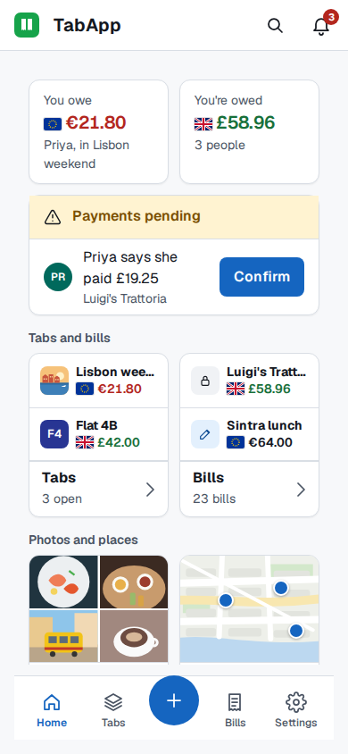 Home</td>
    <td align="center">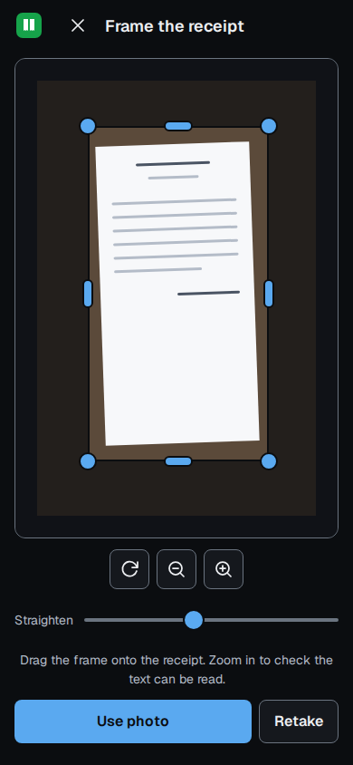 Framing a receipt</td>
    <td align="center">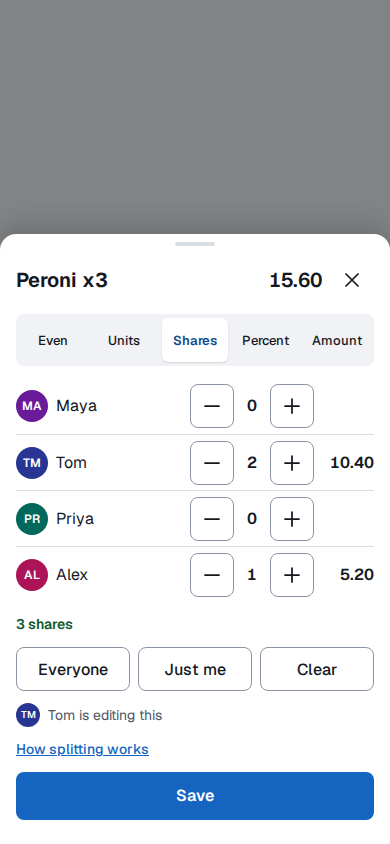 Splitting an item</td>
  </tr>
  <tr>
    <td align="center">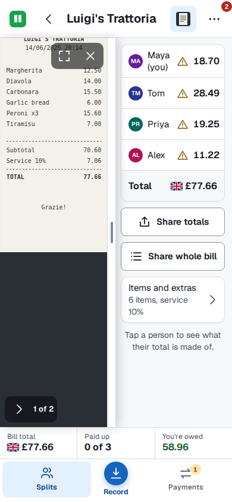 The receipt beside the totals</td>
    <td align="center">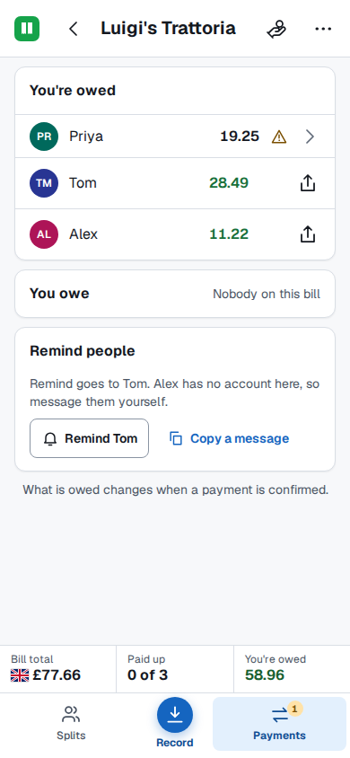 Who owes what</td>
    <td align="center">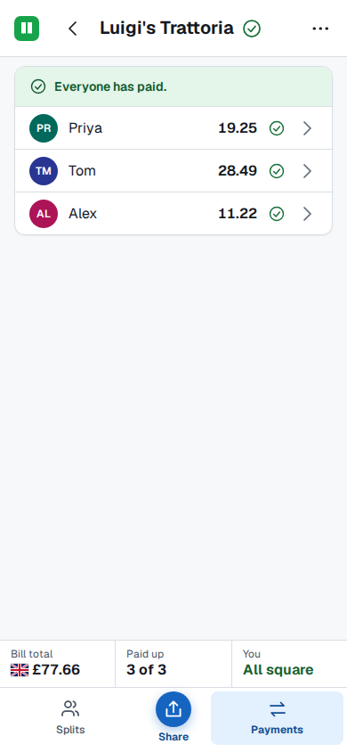 Everyone has paid</td>
  </tr>
  <tr>
    <td align="center">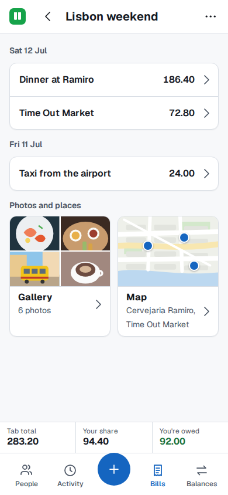 A tab for a weekend away</td>
    <td align="center">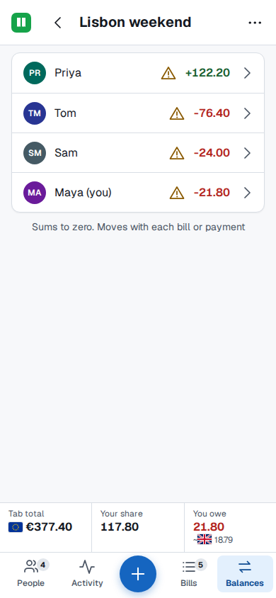 A tab's balances</td>
    <td align="center">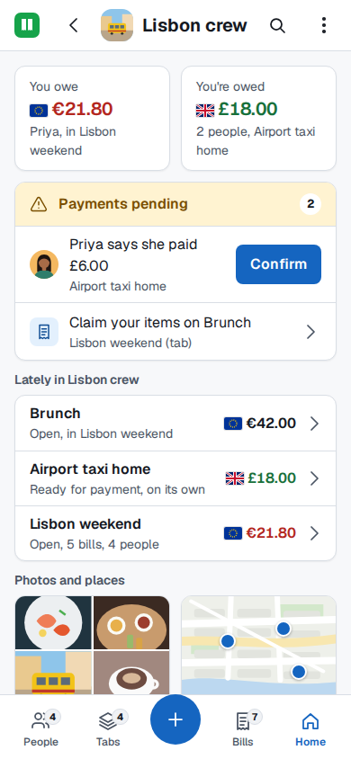 A group</td>
  </tr>
  <tr>
    <td align="center">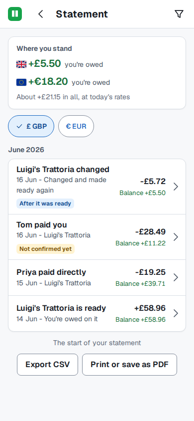 The statement</td>
    <td align="center">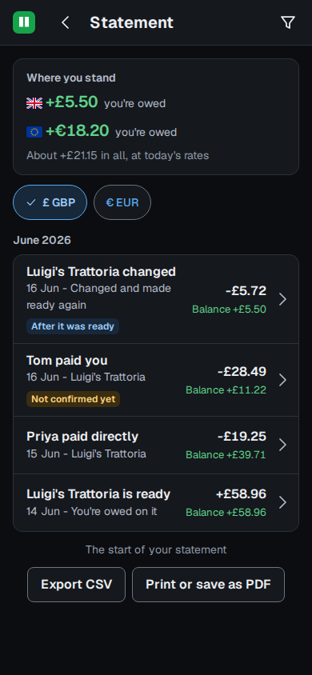 Dark theme</td>
    <td align="center">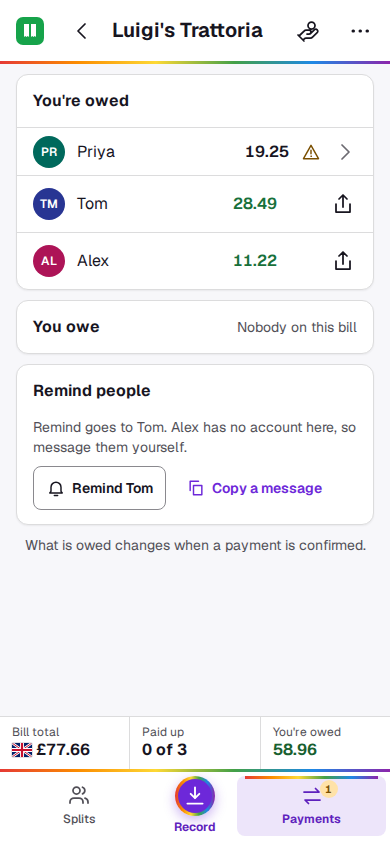 A skin</td>
  </tr>
</table>

## How it is built

- **Next.js and React** in strict TypeScript, with **tRPC** between the screens and the server, hosted on **Vercel**.
- **Each bill, tab and group is a single JSON document** in **Turso** (libSQL). Every copy of a document carries a version, so changes made at the same moment are caught and reconciled instead of one silently overwriting another.
- **Live updates** through Pusher. Everyone with a bill open sees claims and payments as they happen.
- **Offline first.** A service worker and a per-account IndexedDB store keep opened bills readable. Changes made offline are queued and replayed when the connection returns.
- **Money is exact.** Amounts are held in each currency's minor units, and the people's shares of a bill always add up exactly to its total.
- **Receipt reading** with Google Cloud Vision or OpenAI, always reviewed by a person before it becomes a bill.
- **Sign-in** with Clerk. Guests act through a session tied to one seat on one bill.
- **Notifications** by email (Mailgun), text (Twilio) and web push, each switchable per event.
- **Feature flags** with LaunchDarkly, and errors, metrics and logs in Sentry and Grafana.
- **Tested** with Bun's test runner and Playwright end-to-end suites.

## About this repository

This repository is a showcase. TabApp's source code is private and is not published here.

## Contact

Made by [Diego](https://github.com/diegoaltoworks). Questions and feedback are welcome through the contact form at [tabapp.app](https://tabapp.app).

Copyright Diego. All rights reserved.
